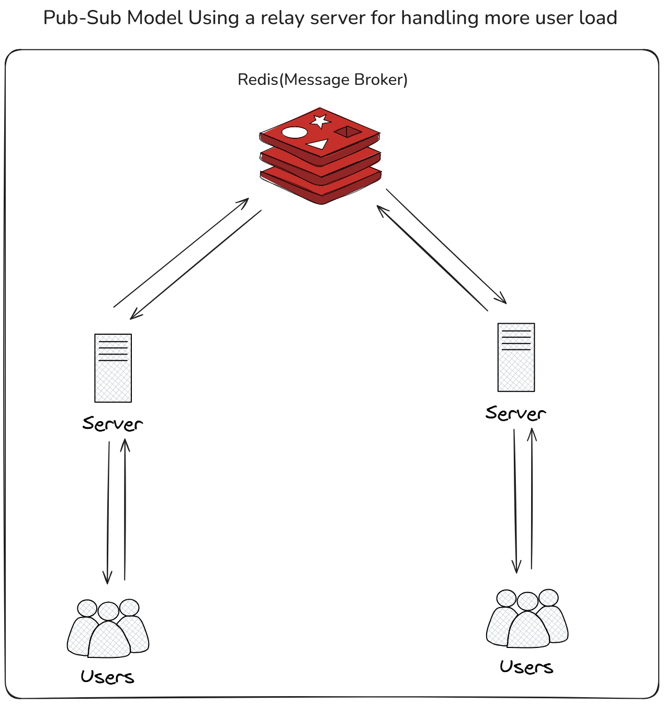
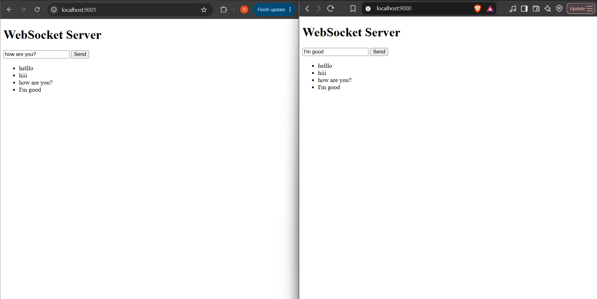

# Scalable Real-Time WebSocket System with Redis Pub/Sub

A lightweight, hands-on implementation demonstrating how to horizontally scale stateful **WebSocket** connections across multiple independent Node.js server instances using a **Redis Pub/Sub relay**.

---

## The Problem: Why Can't We Just "Scale" WebSockets?

Traditional HTTP requests are stateless: any server behind a load balancer can handle any request. **WebSockets are fundamentally different.** They establish a persistent, stateful, two-way TCP connection between a single user and a single server instance.

```
       [User A]                       [User B]
          │                              │
          ▼                              ▼
    ┌───────────┐                  ┌───────────┐
    │  Server 1 │          ???     │  Server 2 │
    │(Port 9000)│ ─── No Direct ── │(Port 9001)│
    └───────────┘    Communication └───────────┘
```

* **The Bottleneck:** A single Node.js instance has finite resources (CPU, memory, file descriptors). To handle thousands or millions of users, we must spin up multiple servers (Server 1, Server 2, Server $N$).
* **The Communication Gap:** If **User A** is connected to **Server 1** and **User B** is connected to **Server 2**, Server 1 has no access to User B's socket. If User A sends a message, Server 1 cannot deliver it to User B.

---

## The Solution: Central Message Relay (Pub/Sub)

To bridge the gap between isolated servers, we introduce **Redis as a central message broker** using the **Publisher/Subscriber (Pub/Sub)** pattern.

### System Architecture



### How It Works Under the Hood:

1. **Independent Server Instances:** We run multiple Node.js instances (e.g., Server 1 on `PORT=9000` and Server 2 on `PORT=9001`).
2. **Dual Redis Connections:** Each server connects to Redis with two distinct clients:
   * **Publisher Client:** Used to push messages into Redis.
   * **Subscriber Client:** Dedicated solely to listening to broadcast channels from Redis.
3. **The Message Flow:**
   * **User A** connects to **Server 1** and sends a chat message.
   * **Server 1** receives the message over WebSocket and **publishes** it to Redis on the channel `ws-messages`.
   * **Redis relays** the published message to **every server instance** subscribed to `ws-messages` (both Server 1 and Server 2).
   * **Server 1 and Server 2** receive the message from Redis and broadcast it locally to all of their actively connected clients.
   * **User B** on Server 2 receives the message seamlessly in real time!

---

## Live Demonstration

Here is the system running with two separate browser clients connected to different server instances (`localhost:9000` and `localhost:9001`). When a message is sent from one instance, it is instantly relayed across the broker and displayed on the other:



---

## Project Structure

```text
websocket/
├── assets/
│   ├── pub-sub-architecture.png   # Architecture diagram
│   └── realtime-messaging.png     # Live client communication screenshot
├── connection.js                  # Redis publisher & subscriber client setup
├── docker-compose.yml             # Redis container configuration
├── index.html                     # Frontend client UI with WebSocket integration
├── package.json                   # Dependencies (ws, ioredis)
└── server.js                      # HTTP & WebSocket server implementation
```

---

## Code Walkthrough

### 1. Redis Connection (`connection.js`)
In Redis, once a connection executes `SUBSCRIBE`, it enters subscriber mode and can no longer execute regular commands (like `PUBLISH`). Therefore, we instantiate two separate `ioredis` clients:

```javascript
import { Redis } from 'ioredis';

// Client for publishing messages
export const redisPublish = new Redis({
  host: process.env.REDIS_HOST || 'localhost',
  port: 6379,
});

// Dedicated client for listening to subscribed channels
export const redisSubscribe = new Redis({
  host: process.env.REDIS_HOST || 'localhost',
  port: 6379,
});
```

### 2. Relay & Broadcast Server (`server.js`)
The server binds HTTP and WebSockets together on a configurable port:

```javascript
const PORT = process.env.PORT || 9000;
const REDIS_CHANNEL = process.env.REDIS_CHANNEL || 'ws-messages'; 

// 1. Subscribe to the Redis channel
redisSubscribe.subscribe(REDIS_CHANNEL);

// 2. When Redis emits a message, broadcast to ALL local connected clients
redisSubscribe.on('message', (channel, message) => {
  if (channel === REDIS_CHANNEL) {
    wsServer.clients.forEach((client) => {
      if (client.readyState === WebSocket.OPEN) {
        client.send(message.toString());
      }
    });
  }
});

// 3. When a local client sends a message, relay it to Redis
wsServer.on('connection', (socket) => {
  socket.on('message', async (data) => {
    await redisPublish.publish(REDIS_CHANNEL, data.toString());
  });
});
```

### 3. Frontend Client (`index.html`)
The client dynamically attaches to the host/port serving the page:

```javascript
const { port } = window.location;
const connection = new WebSocket(`ws://localhost:${port}`);

connection.onmessage = (msg) => {
  const { message } = JSON.parse(msg.data);
  const li = document.createElement('li');
  li.innerText = message;
  messagesContainer.appendChild(li);
};
```

---

## Getting Started

### Prerequisites
* [Node.js](https://nodejs.org/) (v18 or higher)
* [Docker Desktop](https://www.docker.com/products/docker-desktop/) (for running Redis)

### Step 1: Install Dependencies
```bash
npm install
```

### Step 2: Spin Up the Redis Broker
Make sure Docker Desktop is running, then execute:
```bash
docker compose up -d
```
> Verify Redis is healthy with `docker ps`. It will be listening on port `6379`.

### Step 3: Start Multiple Server Instances
Open **two separate terminal windows**:

* **Terminal 1 (Server 1 on port 9000):**
  * *Windows PowerShell:*
    ```powershell
    $env:PORT=9000; node server.js
    ```
  * *macOS / Linux / Bash:*
    ```bash
    PORT=9000 node server.js
    ```

* **Terminal 2 (Server 2 on port 9001):**
  * *Windows PowerShell:*
    ```powershell
    $env:PORT=9001; node server.js
    ```
  * *macOS / Linux / Bash:*
    ```bash
    PORT=9001 node server.js
    ```

### Step 4: Test Real-Time Communication
1. Open Browser Tab 1: [`http://localhost:9000`](http://localhost:9000)
2. Open Browser Tab 2: [`http://localhost:9001`](http://localhost:9001)
3. Type a message in Tab 1 and hit **Send**.
4. Notice how the message is published to Redis, relayed across servers, and immediately displayed in Tab 2!

---

## Production Considerations & Next Steps

While this project demonstrates the core scaling concept, consider the following improvements for enterprise production:

1. **Reverse Proxy / Load Balancer:**
   Place **Nginx**, **HAProxy**, or an **AWS ALB** in front of your Node instances. Users connect to a single endpoint (`wss://chat.yourdomain.com`), and the proxy balances connections across instances with sticky sessions / SSL termination.
2. **Channel Granularity (Rooms/Topics):**
   Instead of a single global `ws-messages` channel, partition messages into room-specific channels (e.g., `room:101`, `chat:direct:user1_user2`) so servers only process traffic relevant to their connected users.
3. **Delivery Guarantees (Streams vs. Pub/Sub):**
   Redis standard Pub/Sub is "fire-and-forget" (at-most-once delivery). If an instance experiences transient network failure, messages during that window are lost. For mission-critical message persistence and history, consider **Redis Streams** (`XADD`/Consumer Groups).
4. **Heartbeats & Cleanup:**
   Implement `ping`/`pong` heartbeats to detect and terminate zombie or half-open TCP connections.
